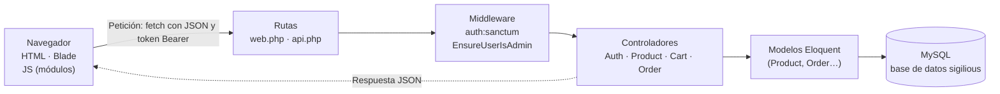

# Arquitectura de Sigilious

> Esta documentación se ha elaborado exclusivamente a partir de la guía técnica `Sigilious_Guia_Tecnica.pdf` (octubre de 2026, basada en el código del proyecto con 6 commits). No se ha contrastado con el código fuente: los puntos marcados como **pendiente de verificación** deben comprobarse manualmente en el repositorio.

## 1. Descripción general y objetivo

Sigilious es una tienda online de ropa. Empezó siendo solo frontend (HTML, CSS y JavaScript) con un backend en Supabase que dejó de funcionar. El objetivo del trabajo ha sido convertirla en una **aplicación full stack**: un proyecto Laravel (PHP) con una base de datos MySQL, una API propia y un panel de administración.

- **Autor:** Rubén Barrutia Grasa (DAW, Barcelona).
- **Repositorio:** [github.com/RubenBG0204/sigilious-laravel](https://github.com/RubenBG0204/sigilious-laravel)
- **Estado:** funciona en local. Todavía no está desplegada ni tiene pagos reales (ver [limitaciones y mejoras](seguridad-y-mejoras.md#limitaciones-y-mejoras-pendientes)).

Qué ofrece la aplicación:

- API REST con autenticación por tokens (Laravel Sanctum).
- Catálogo de productos servido desde MySQL.
- Carrito guardado por usuario.
- Pedidos cuyo total calcula el servidor a partir de los precios de la base de datos, sin fiarse del navegador.
- Panel de administración de productos protegido con un middleware.

## 2. Evolución del proyecto

| Aspecto | Antes | Ahora |
|---|---|---|
| Productos | Lista fija en JavaScript y datos en Supabase | Tabla `products` en MySQL, servida por `/api/products` |
| Usuarios | Supabase y almacenamiento del navegador | Tabla `users` con contraseña cifrada y tokens de Laravel Sanctum |
| Carrito | Solo `localStorage` | `localStorage` + tabla `carts` por usuario (le sigue entre navegadores) |
| Pedidos | Guardados en el navegador | Tabla `orders`; el total lo calcula el servidor |
| Administración | Sin control de permisos en un servidor propio | Rutas de API protegidas: solo usuarios con `is_admin = 1` |
| Código | Carpeta suelta | Repositorio Git con 6 commits, README y `.env` fuera del repositorio |

El orden en que se construyó cada pieza está en [historial-desarrollo.md](historial-desarrollo.md).

## 3. Tecnologías

| Capa | Tecnología | Para qué se usa aquí |
|---|---|---|
| Backend | PHP 8.3+, Laravel 13 | Rutas, controladores, validación, modelos y migraciones |
| Autenticación | Laravel Sanctum 4 | Tokens Bearer para API (registro, login, logout, rutas protegidas) |
| Base de datos | MySQL (Laragon) + phpMyAdmin | Almacenar productos, usuarios, carritos y pedidos |
| Frontend | Blade, HTML5, CSS3, JavaScript (módulos ES) | Páginas, interfaz y llamadas `fetch` a la API |
| Herramientas | Laragon, Composer, Git/GitHub, VS Code, Chrome DevTools | Entorno local, dependencias, control de versiones y depuración |

Cómo se usa cada herramienta durante la instalación y el desarrollo: [instalacion.md](instalacion.md#herramientas-necesarias).

## 4. Arquitectura general

Recorrido de una petición:

1. El navegador carga una página Blade (HTML).
2. El JavaScript de esa página llama con `fetch` a la API (JSON y token Bearer).
3. Laravel enruta la petición y pasa por los middleware (por ejemplo, comprobar el token).
4. La petición llega a un controlador, que usa los modelos Eloquent para leer o escribir en MySQL.
5. El controlador devuelve JSON y el JavaScript pinta el resultado.

## 5. Estructura de un proyecto Laravel

| Carpeta / archivo | Qué contiene | En Sigilious |
|---|---|---|
| `app/Models` | Clases que representan tablas (Eloquent). | `Product`, `Cart`, `Order`, `User` |
| `app/Http/Controllers` | La lógica de cada endpoint. | `AuthController`, `ProductController`, `CartController`, `OrderController` |
| `app/Http/Middleware` | Filtros por los que pasa una petición antes del controlador. | `EnsureUserIsAdmin` |
| `routes/web.php` | Rutas de páginas (devuelven HTML). | 14 rutas de página (`Route::view`) y `GET /api/products` |
| `routes/api.php` | Rutas de la API (JSON). Laravel les añade el prefijo `/api`. | `register`, `login`, `logout`, `orders`, `cart`, `products` (admin) |
| `resources/views` | Plantillas Blade (HTML). | `index`, `shop`, `product`, `cart`, `checkout`, `login`, `admin`… |
| `public` | Lo único accesible desde el navegador: `index.php`, CSS, JS. | `public/css/*.css`, `public/js/*.js` |
| `database/migrations` | Historial de cambios del esquema de la base de datos. | `products`, `carts`, `orders`, tokens, `is_admin` |
| `database/seeders` | Datos iniciales. | `ProductSeeder` (9 productos) |
| `bootstrap/app.php` | Arranque de la aplicación: rutas, middleware, errores. | Registra `api.php` y fuerza respuestas JSON en `/api/*` |
| `config` | Configuración (base de datos, auth, sanctum…). | `config/sanctum.php` (se creó al instalar la API) |
| `vendor` | Dependencias de Composer (no se sube a Git). | Laravel, Sanctum… |
| `.env` | Configuración local y secretos (no se sube a Git). | Datos de MySQL (ver [instalacion.md](instalacion.md#configuración-del-entorno-env)) |

> **Pendiente de verificación:** la guía indica que `web.php` contiene 14 rutas de página, pero solo muestra explícitamente `/`, `/shop`, `/cart`, `/login` y `/admin` (el resto del listado aparece abreviado con `...`). Las vistas citadas son `index`, `shop`, `product`, `cart`, `checkout`, `login` y `admin`, y la guía menciona también una pantalla `/orders`. La lista completa de las 14 rutas debe comprobarse con `php artisan route:list`.

## 6. Comunicación entre frontend, backend y base de datos

### 6.1 Archivos JavaScript y su responsabilidad

| Archivo | Responsabilidad |
|---|---|
| `script.js` | Punto de entrada. Importa todo, sincroniza datos al cargar y arranca la función de la página actual (`initShop`, `initCart`…) según `data-page`. |
| `products.js` | Productos: caché en `localStorage`, filtros, sincronización con `/api/products` y llamadas de administrador (con token). |
| `users.js` | Registro, login, logout y sesión actual. |
| `cart.js` | Carrito local y sincronización con `/api/cart`. |
| `orders.js` | Crear pedidos (`POST /api/orders`) y leer los del usuario. |
| `ui.js`, `ui-helpers.js` | Menú, animaciones, avisos (toasts), validación de formularios, formato de precios. |
| `router.js` | Casi vacío (reservado para una posible SPA). |

Los archivos están en `public/js/`. Las funcionalidades que implementa cada uno se describen en [funcionalidades.md](funcionalidades.md).

### 6.2 Páginas Blade y arranque del JavaScript

Cada página Blade declara qué es con un atributo en el `<body>` (por ejemplo `data-page="shop"`); `script.js` lo lee y arranca solo el código de esa página. Las rutas de las páginas están en `routes/web.php` (ver [funcionalidades.md](funcionalidades.md#páginas-y-rutas-web)).

### 6.3 Sincronización al cargar y respaldo local

Al cargar cualquier página, `script.js` ejecuta `await syncProductsFromSupabase()`, `syncCartFromSupabase()` y `syncOrdersFromSupabase()`. Si el servidor no responde, cada función cae al dato guardado en `localStorage` para que la web siga funcionando.

### 6.4 Qué se guarda en el navegador (`localStorage`)

| Clave | Contenido | Fuente de verdad |
|---|---|---|
| `sigilious_products` | Copia del catálogo | MySQL (`products`) |
| `sigilious_cart` | Carrito actual: id, cantidad, talla | Invitado: el navegador. Con sesión: MySQL (`carts`) |
| `sigilious_orders` | Copia de los pedidos | MySQL (`orders`) |
| `sigilious_current_user` | Usuario y token de acceso | El navegador (el token se valida en el servidor) |

Las funciones con nombres heredados de la versión anterior (`syncProductsFromSupabase`, etc.) se explican en [funcionalidades.md](funcionalidades.md#catálogo-y-filtros-de-productos).

## 7. Responsabilidades de los controladores

| Controlador | Métodos | Puntos clave |
|---|---|---|
| `AuthController` | `register`, `login`, `logout`, `payload` | Validación, `Hash::check`, `createToken`, borrado del token actual |
| `ProductController` | `index`, `store`, `update`, `destroy`, `validated` | Una única función de validación reutilizada; `store` pone tallas S, M, L, XL por defecto |
| `CartController` | `show`, `update` | `updateOrCreate` por `user_id`; cantidades 1 a 20 |
| `OrderController` | `index`, `store` | Precio desde BD, total en servidor, `user('sanctum')` opcional |

El middleware `EnsureUserIsAdmin` filtra las rutas de administración antes de llegar a `ProductController` (ver [funcionalidades.md](funcionalidades.md#panel-de-administración)). Los endpoints concretos están en [api.md](api.md).

## 8. Conceptos técnicos necesarios

| Término | Significado |
|---|---|
| API REST | Conjunto de URL que devuelven y reciben datos (JSON) usando métodos HTTP: `GET` leer, `POST` crear, `PUT` actualizar, `DELETE` borrar. |
| JSON | Formato de texto para intercambiar datos: `{ "name": "Gorra" }`. |
| ORM / Eloquent | Permite trabajar con tablas como si fueran clases (`Product::all()`) en vez de escribir SQL. |
| Migración | Archivo que describe un cambio en el esquema de la base de datos. |
| Seeder | Clase que inserta datos iniciales. |
| Middleware | Filtro que se ejecuta antes del controlador (por ejemplo, comprobar permisos). |
| Token Bearer | Cadena secreta enviada en `Authorization: Bearer ...` para identificar al usuario en cada petición. |
| Hash | Transformación irreversible de una contraseña; solo se puede comprobar, no descifrar. |
| Blade | Motor de plantillas de Laravel (`.blade.php`). |
| Route model binding | Laravel convierte `{product}` de la URL en el objeto `Product` ya cargado. |
| Asignación masiva | Rellenar un modelo con muchos campos a la vez; se controla con `$fillable`. |
| CRUD | Create, Read, Update, Delete: las cuatro operaciones básicas sobre datos. |
| `localStorage` | Almacenamiento del navegador por sitio; sobrevive al cerrar la pestaña. |
| XSS | Inyección de código JavaScript en una página, típicamente por mostrar texto sin escapar. |

Detalle de Eloquent, migraciones y seeders: [base-de-datos.md](base-de-datos.md). Medidas de seguridad asociadas a estos conceptos: [seguridad-y-mejoras.md](seguridad-y-mejoras.md).
