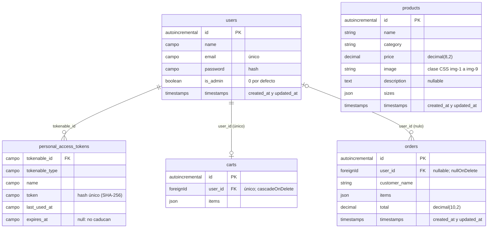

# Base de datos

> Documentación elaborada solo a partir de `Sigilious_Guia_Tecnica.pdf`. No se ha contrastado con el código fuente.

## 1. Descripción general

Sigilious usa **MySQL** (servido por Laragon y gestionado con phpMyAdmin) con una base de datos llamada `sigilious`. Laravel no crea la base: hay que crearla vacía en phpMyAdmin, y Laravel solo crea las tablas dentro mediante migraciones (ver [instalacion.md](instalacion.md#configuración-de-mysql)).

Tablas de la aplicación: `products`, `users`, `personal_access_tokens`, `carts` y `orders`. Además existen las tablas propias de Laravel (ver [sección 3.6](#36-tablas-propias-de-laravel)).

## 2. Diagrama entidad-relación

El diagrama incluye solo las columnas y relaciones que aparecen en la guía. Donde la guía no indica el tipo de dato de una columna se usa `campo`.



Relaciones según la guía:

| Relación | Cardinalidad | Detalle |
|---|---|---|
| `users` → `personal_access_tokens` | 1 : N | Vía `tokenable_id` (la guía indica `tokenable_id/type`). |
| `users` → `carts` | 1 : 1 | `carts.user_id` es único: como máximo un carrito por usuario. |
| `users` → `orders` | 1 : N (opcional) | `orders.user_id` es nulo en pedidos de invitado. |
| `products` | Sin relaciones | Los pedidos guardan una copia (nombre y precio) del producto en el momento de comprar. |

## 3. Tablas

### 3.1 `products`

Catálogo de la tienda. Contiene los 9 productos cargados por el seeder. Migración:

```php
Schema::create('products', function (Blueprint $table) {
    $table->id();                          // id autoincremental
    $table->string('name');
    $table->string('category');            // tshirts, hoodies, pants, accessories, shoes
    $table->decimal('price', 8, 2);        // dinero con 2 decimales
    $table->string('image');               // clase CSS: img-1 ... img-9
    $table->text('description')->nullable();
    $table->json('sizes');                 // ["S","M","L","XL"]
    $table->timestamps();                  // created_at y updated_at
});
```

| Columna | Tipo | Notas |
|---|---|---|
| `id` | `id()` autoincremental | Clave primaria. |
| `name` | `string` | |
| `category` | `string` | Valores usados: `tshirts`, `hoodies`, `pants`, `accessories`, `shoes`. |
| `price` | `decimal(8,2)` | Se devuelve como texto en la API (por ejemplo `"42.00"`). |
| `image` | `string` | Es una clase CSS (`img-1` a `img-9`), no un archivo. |
| `description` | `text`, nulo | |
| `sizes` | `json` | Por ejemplo `["S","M","L","XL"]`. |
| `created_at`, `updated_at` | `timestamps()` | |

### 3.2 `users`

Creada por Laravel; se añadió la columna `is_admin` con una migración posterior:

```php
// migración
$table->boolean('is_admin')->default(false)->after('password');
```

| Columna | Tipo | Notas |
|---|---|---|
| `id` | — | Clave primaria (no hay que tocarla al hacer administrador a un usuario). |
| `name` | — | |
| `email` | — | Único (`unique:users,email` en el registro). |
| `password` | — | Hash. El cast `'password' => 'hashed'` lo cifra al guardar (bcrypt por defecto). |
| `is_admin` | boolean | `0` por defecto. No es rellenable desde el registro. |
| timestamps | — | |

### 3.3 `personal_access_tokens`

Tokens de Sanctum. La migración la crea `php artisan install:api`. Solo se guarda el hash del token, nunca el token en claro.

| Columna | Notas |
|---|---|
| `tokenable_id` / `tokenable_type` | Referencia al usuario propietario del token. |
| `name` | Nombre del token (en Sigilious, `'sigilious'`). |
| `token` | Hash único (SHA-256). |
| `last_used_at` | |
| `expires_at` | La expiración está en `null`: los tokens no caducan. |

### 3.4 `carts`

Un carrito por usuario. Se borra junto con el usuario.

```php
$table->foreignId('user_id')->unique()->constrained()->cascadeOnDelete();
$table->json('items'); // [{ "id": "3", "qty": 2, "size": "M" }, ...]
```

- `unique()` en `user_id`: cada usuario tiene como máximo un carrito.
- `cascadeOnDelete()`: si se borra el usuario, se borra su carrito.
- La guía muestra solo estas dos líneas de la migración. Las columnas principales que indica son `id`, `user_id` (único) e `items` (JSON).

### 3.5 `orders`

```php
Schema::create('orders', function (Blueprint $table) {
    $table->id();
    $table->foreignId('user_id')->nullable()->constrained()->nullOnDelete();
    $table->string('customer_name');
    $table->json('items');                 // copia de las líneas del pedido
    $table->decimal('total', 10, 2);
    $table->timestamps();
});
```

- `user_id` es `nullable`: se puede comprar sin cuenta (invitado). `nullOnDelete()` hace que, si se borra el usuario, sus pedidos se conserven con `user_id = NULL`.
- `items` es JSON: guarda una copia (nombre, precio, talla, cantidad) de lo comprado, para que el pedido no cambie si luego se edita el producto.
- El total se calcula en el servidor (ver [funcionalidades.md](funcionalidades.md#pedidos)).

### 3.6 Tablas propias de Laravel

`sessions`, `cache`, `jobs`, `password_reset_tokens` y `migrations`. La guía indica que se usa `SESSION_DRIVER=database` y `CACHE_STORE=database`. La tabla `migrations` anota qué migraciones ya se ejecutaron.

## 4. Modelos Eloquent

Cada tabla tiene un modelo en `app/Models`. Eloquent es el ORM de Laravel: en vez de escribir SQL se usa `Product::all()`, `Product::create()`, etc. Por debajo usa consultas preparadas (protege contra inyección SQL).

```php
class Product extends Model
{
    protected $fillable = ['name', 'category', 'price', 'image', 'description', 'sizes'];
    protected $casts = ['sizes' => 'array']; // JSON <-> array de PHP automáticamente
}
```

- `$fillable` lista los campos que se pueden rellenar de golpe con `Product::create([...])`. Protege contra la asignación masiva (que alguien envíe un campo que no debe).
- `$casts` convierte el JSON de la columna `sizes` en un array de PHP al leer y lo vuelve JSON al guardar.

El modelo `User` (con `HasApiTokens` y los casts `hashed` y `boolean`) se describe en [funcionalidades.md](funcionalidades.md#registro-inicio-y-cierre-de-sesión). La guía no muestra el código de los modelos `Cart` y `Order`.

## 5. Migraciones y seeders

Una **migración** es código que describe un cambio en la base de datos. Ventaja: cualquiera que clone el proyecto ejecuta `php artisan migrate` y obtiene exactamente las mismas tablas. Migraciones del proyecto: `products`, `personal_access_tokens`, `orders`, `carts` y `add_is_admin_to_users_table`. El orden en que se crearon está en [historial-desarrollo.md](historial-desarrollo.md).

Un **seeder** inserta datos iniciales. `ProductSeeder` carga los 9 productos:

```php
foreach ($products as $product) {
    Product::updateOrCreate(['name' => $product['name']], $product);
}
```

`updateOrCreate` busca un producto con ese nombre: si existe, lo actualiza; si no, lo crea. Por eso se puede ejecutar el seeder varias veces sin duplicar productos, **pero sí sobrescribe** los cambios que se hayan hecho a mano en esos 9 productos (por ejemplo, una descripción editada en phpMyAdmin). Los comandos para ejecutar migraciones y seeders están en [instalacion.md](instalacion.md#migraciones-y-seeders).

## 6. JSON en `items` y `sizes`

Los campos `items` (pedidos y carritos) y `sizes` (productos) se guardan como JSON porque es más simple y suficiente para un proyecto de este tamaño. La alternativa más «académica» sería una tabla `order_items` con una fila por línea y una tabla `sizes` relacionada; permitiría consultas SQL por producto vendido, a cambio de más tablas y código.

## 7. Consultas útiles en phpMyAdmin (pestaña SQL)

```sql
SELECT id, name, price FROM products;
SELECT id, email, is_admin FROM users;
UPDATE users SET is_admin = 1 WHERE email = 'tu@correo.com';
SELECT id, user_id, customer_name, total, created_at FROM orders ORDER BY id DESC;
```

La tercera consulta se usa para hacer administrador a un usuario (ver [instalacion.md](instalacion.md#crear-un-administrador)). `tu@correo.com` es un marcador: sustitúyelo por el email de tu cuenta.
